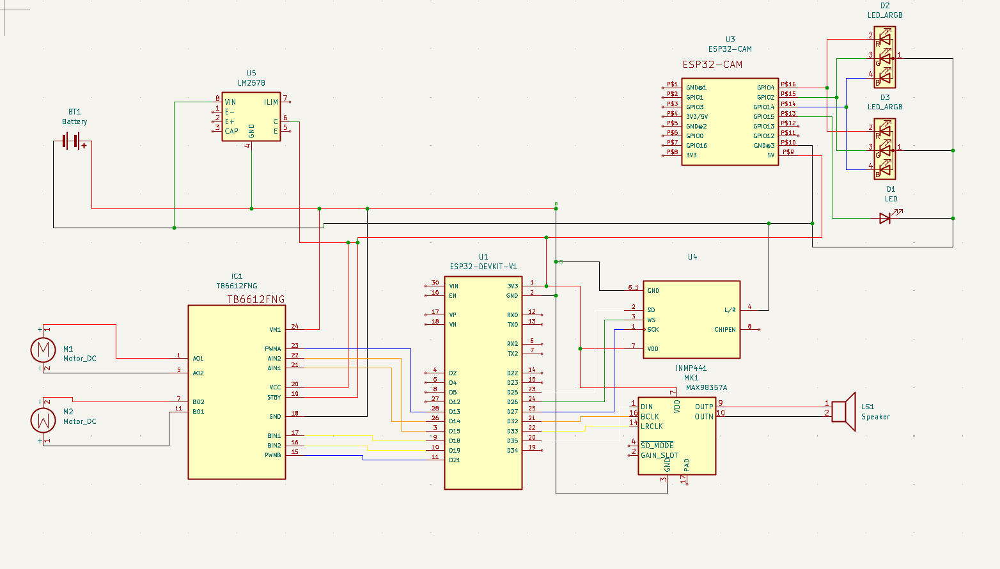

# Gabrino — A Desktop Robot Assistant
### *A little robot that keeps a college student connected to the annoying little brother she left back home.*

[]()
[]()
[]()
[]()

---

## About

I built Gabrino as a gift for my sister, who leaves for college in a few months. To keep the legacy of the annoying little brother alive, she can bring Gabrino with her — so I can hang out with her, tour UCLA, and bother her from home whenever I want.

I'm not *all* annoying though, so I'm building in some functions to actually help her through college too.

### Features

Legend: ✅ working · 🚧 in progress · 📋 planned

- 🔊 ✅ **MAX98357A-driven speaker** — plays audio streamed back from the server
- 🌐 ✅ **Flask API server** — the hub that connects her, me, and the robot
- 💻 ✅ **React + Vite frontend** — drive the robot and watch the serial monitor
- 🎙️ 🚧 **INMP441 microphone** — captures audio input (I2S streaming written, capture path not yet enabled)
- 📷 📋 **High-quality camera stream** — to see (and bother) her whenever I want
- 🤖 📋 **AI assistant** — answers quick questions and sets alarms
- 🖥️ 📋 **1" OLED screen** — shows the time, weather, or any visual indicator
- 📡 📋 **Stationary ESP32 WiFi gateway** — lets her control Gabrino remotely

<p align="center">
  
</p>

---

## Tech Stack

| Layer | Technology |
|---|---|
| Firmware (ESP32) | C++ |
| Backend API | Python (Flask) |
| Frontend | React, TypeScript, Vite |
| Styling | CSS |

**Language breakdown:** C++ 44.7% · CSS 20.9% · TypeScript 16.7% · Python 13.5% · JavaScript 2.4% · HTML 1.5% · C 0.3%

---

## Building Your Own Gabrino

You'll need to buy the parts and CAD your own model, but here's the electrical setup:

**1. Copy the schematic below**

<p align="center">
  
</p>

**2. Clone this project**

```bash
git clone <repo-url>
```

**3. Upload the firmware** via [Arduino IDE](https://support.arduino.cc/hc/en-us/articles/360019833020-Download-and-install-Arduino-IDE)

**4. Run the Flask API server**

```bash
cd server
python3 -m venv ./venv
source venv/bin/activate
pip3 install -r requirements.txt
python3 app.py
```

**5. Run the frontend**

```bash
cd frontend
npm install
npm run dev
```

---

## Using This for Your Own Purposes

For all my fellow little brothers out there — CAD your own robot and give it to your sister, so you can annoy her too.

For fellow developers — feel free to use my code, whether you want to stream audio from an INMP441 to your server or wire an API server up to a hardware project.
