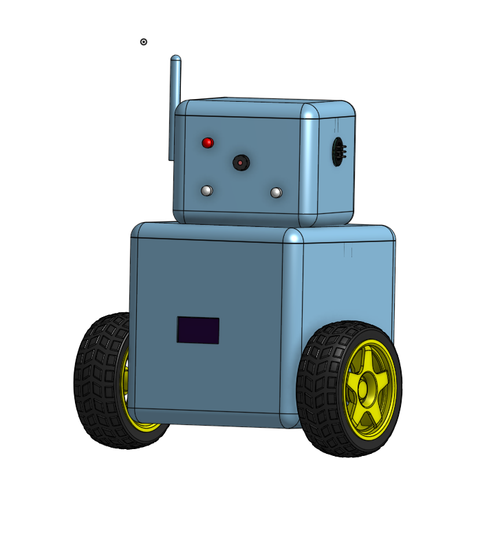

# Gabrino — A Desktop Robot Assistant
### *A robot assistant capable of communicating with its users, and connecting college students to their family back home.*

[]()
[]()
[]()
[]()

---

## About

This project was built as a gift for my sister, who is leaving for college in a few months. In order to continue the legacy of the annoying little brother, I built Gabrino. As my sister leaves for college, she can bring Gabrino with her, enabling me to hang out with her, tour UCLA, and annoy her whenever I want.

I'm not all annoying though, so I built some functions to help her throughout college:

- 🎙️ **INMP441 microphone** — captures audio input
- 🔊 **MAX98357A-driven speaker** — relays audio back to her
- 🤖 **AI assistant** — answers quick questions and sets alarms
- 🖥️ **1" OLED screen** — shows the time, weather, or any visual indicator
- 🌐 **Flask API server** — connects her with me and the assistant
- 📷 **High-quality camera stream** — to bother her whenever I want
- 💻 **React + Vite frontend** — controls the robot
- 📡 **Stationary ESP32 WiFi gateway** — lets her control Gabrino remotely

<p align="center">
  
</p>

---

## Tech Stack

| Layer | Technology |
|---|---|
| Firmware (ESP32) | C++ |
| Backend API | Python (Flask) |
| Frontend | React, TypeScript, Vite |
| Styling | CSS |

**Language breakdown:** C++ 44.7% · CSS 20.9% · TypeScript 16.7% · Python 13.5% · JavaScript 2.4% · HTML 1.5% · C 0.3%

---

## Building Your Own Gabrino

You will need to purchase all the parts and CAD your own model, but here's the electrical setup:

1. **Copy the schematic below**

   

2. **Clone this project**
```bash
   git clone <repo-url>
```

3. **Upload the firmware** via [Arduino IDE](https://support.arduino.cc/hc/en-us/articles/360019833020-Download-and-install-Arduino-IDE)

4. **Run the Flask API server**
```bash
   cd server
   python3 -m venv ./venv
   source venv/bin/activate
   pip3 install -r requirements.txt
   python3 app.py
```

5. **Run the frontend**
```bash
   cd frontend
   npm run dev
```

---

## Using This for Your Own Purposes

For all my fellow little brothers out there — CAD your own robot, and give it to your sister, so you can annoy her.

For fellow developers — feel free to use my code whether you want to stream audio from the INMP441 to your server, or connect API servers to hardware projects.
